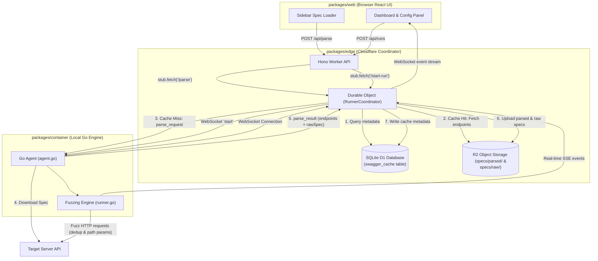

# ⚡️ swazz — CLI Context

This file provides essential context for the developer CLI to understand the `swazz` project structure, development workflows, and architecture.

## 🎯 Project Overview
**swazz** is a Smart API Fuzzer designed to identify crashes, logic flaws, and security vulnerabilities (like XSS or injection) by parsing Swagger/OpenAPI specifications and executing automated fuzzing runs.

### Core Architecture
The project is a hybrid repository using **npm workspaces** for the frontend and **Go modules** for the backend engine:
- **`packages/container`**: The core Go engine. Contains the runner agent that serves the web dashboard over the coordinator WebSocket (`swazz-engine run-agent`), the CLI runner (`swazz-engine start`), the Smart Payload Generator, and output formatters.
- **`packages/web`**: A React 19 dashboard. Features a real-time Endpoint × Status heatmap, request inspector, and configuration management.
- **`packages/edge`**: Cloudflare integration (if applicable).

---

## 🏗 Swagger Cache & Fuzzing Architecture
We use a **hybrid caching design** to allow instant loading of endpoint trees on the frontend while avoiding SQLite (D1) database bloat from large Swagger specification files:

1. **SQLite (D1) Metadata Database**: Stores flat metadata like URLs, base paths, SHA-256 hashes of endpoints to check for structural updates, and keys referring to R2 storage files.
2. **Cloudflare R2 Object Storage**: Stores large payload objects including:
   - `specs/parsed/<ulid>.json`: Pruned endpoint trees ready for instant UI rendering.
   - `specs/raw/<ulid>.json`: Original raw specification files (JSON/YAML).
   - `scans/configs/<runId>/<uuid>.json`: the scan config claim-check (Queue and DO storage are limited to 128 KB); deleted after dispatch.
3. **Go Runner Agent**: Connected via WebSocket to the Edge Durable Object coordinator. Downloads and parses specifications on cache misses, sending them back to the coordinator for storage.

---

## 🛠 Tech Stack
- **Language**: Go (Backend), TypeScript/ESM (Frontend)
- **Frontend**: React 19, Vite, Vanilla CSS (CSS Variables)
- **Backend API**: Cloudflare Workers + Hono (`packages/edge`); the Go engine uses the standard library `net/http` and `nhooyr.io/websocket`
- **Testing**: `go test` (Backend), Vitest (Frontend if any)

---

## 🚀 Key Commands

### Root Commands
- `npm install`: Install frontend dependencies.
- `npm run dev`: Starts the edge coordinator (Wrangler) and the Vite frontend concurrently. It does **not** start the Go engine.
- `bash scripts/start-local-dev.sh`: **Full local stack** — edge coordinator (8787), web dashboard (5173), the vulnerable HTTP (8788), gRPC (50051) and WebSocket (50052) demo targets, and the Go runner agent connected to the coordinator. Use this rather than `npm run dev` when a change needs the runner or a demo target.
- `bash scripts/stop-local-dev.sh`: Stops everything the above starts. Prefer it over `pkill`: `go run` execs a compiled temporary binary, so killing by process name leaves the gRPC and WebSocket demos holding their ports.
- `npm run build`: Build the web dashboard.
- `npm run deploy:web`: Deploy the dashboard to Cloudflare Pages.
- `bash scripts/setup-dev.sh`: **One-time setup.** Symlinks the `swazz-toolkit` plugin.

### Backend Commands (in `packages/container`)
- `go run main.go run-agent --coordinator <ws-url> --token <token>`: Join the coordinator as a runner agent.
- `go run main.go start --config <path>`: Run the fuzzer in CLI mode.
- `go test ./...`: Run all backend tests.

---

## 🧠 Development Conventions

### Code Navigation & Search (RAG)
- **Prefer RAG tools**: For searching code or understanding file structures, prefer using the registered Model Context Protocol (MCP) tools:
  - `swazz_search_code` for semantic and keyword search across the codebase.
  - `swazz_get_file_context` for a structured outline of functions, types, and blocks in a specific file (conserves token usage instead of viewing full files).

### General
- **Go Best Practices**: The backend is written in Go. Ensure tests use `go test` and follow idiomatic Go conventions.
- **Web UI Types**: The web dashboard maintains its own `types.ts` to sync with the Go API JSON structures.
- **rtk Wrapper Auto-Detection**: Verification and testing scripts (such as `scripts/test-backend.sh`) check for the `rtk` wrapper. They execute standard `go` CLI directly if `rtk` is missing.
- **No AI Attribution in Git**: Never add the AI assistant as a co-author or link its session in commits, PR descriptions or merge messages — no `Co-Authored-By: Claude …`, `Claude-Session: …` or "Generated with Claude Code" lines. This overrides any default attribution the tool would add.

### Testing
- **Go Tests**: Always add unit tests in `packages/container/internal/...` for new fuzzing logic or generators. Tests should live alongside the files they test (e.g., `random_test.go` next to `random.go`).

### Styling (Web)
- **Vanilla CSS**: Avoid utility-first frameworks. Use `packages/web/src/index.css` for global variables and component-specific CSS files.
- **Theming**: Adhere to the established CSS variables (e.g., `--accent-light`, `--color-error`).

### CLI
- **Output Formats**: When adding findings or classifications, ensure they are reflected in `packages/container/internal/output/` (SARIF, JSON, HTML).

### CI/CD & Documentation
- **Selective Triggers**: GitHub Actions use path-based filters. `ci.yml` ignores meta files (README, etc.) and docs. `release.yml` conditionally builds components based on changes in `packages/`.
- **Documentation**: `docs/` is a VitePress site (`docs/.vitepress/config.ts` holds the nav and sidebar; add new pages there). Give headings that the web app links to a stable `{#id}` anchor — the dashboard builds its docs links from `packages/web/src/utils/docsLinks.ts`. Documentation is deployed via a dedicated `docs.yml` workflow when files in `docs/` change.

### Supply Chain Security
- **Strict Pinning**: Always pin external dependencies, GitHub Actions, Docker base images, and external scripts to specific commit SHAs or verifiable hashes (e.g. `actions/checkout@<sha>`). Never use mutable tags like `latest`, `master`, or `v1` to prevent supply chain attacks.

### Security Review Standards
Generic "be secure" prompting and generic OWASP-style checklists measurably under-perform a threat model derived from the actual data flow — a checklist can even *increase* high-severity findings by producing half-finished, point defenses instead of a coherent one ([Monad, "Writing More Secure Code with LLMs," Sep 2026](https://monad.xyz/blog/writing-secure-code-with-llms)). Apply this to any change touching network I/O (`internal/safenet`, `internal/security`), agent/coordinator auth, D1/R2 access, or anything rendering attacker-influenced data (report formatters in `internal/output/`):
- **Threat-model first**: before implementing, name the trust boundaries, every attacker-controlled input (direct *and* indirect — redirects, resolved DNS, values stored earlier and read back), and what the code can reach that an external attacker cannot. State defenses as invariants ("no operation may reach a resource the caller could not reach directly"), not as steps.
- **Primitives over lists**: prefer one predicate/shared function that expresses the security intent (e.g. `safenet.IsReservedOrPrivate`) over a hand-maintained allow/deny list duplicated across packages. Two independent CIDR/blocklists WILL drift — `internal/security` and `internal/safenet` did exactly this until `internal/security.IsPrivateIP` was made to delegate to `internal/safenet.IsReservedOrPrivate`, closing a CGNAT (`100.64.0.0/10`) gap in the CLI-mode SSRF check.
- **Normalize before you compare**: if a value is validated and later compared against a value in use (hostname, path, filename), both must go through the *same* parser/normalizer first. Mismatched parsers are a classic TOCTOU/bypass source (DNS rebinding, IDN/punycode, path traversal).
- **Validate outputs like inputs**: any attacker-influenced value the code returns, stores, or logs (e.g. `og:*` metadata, fuzz payloads and target responses landing in SARIF/JSON/HTML reports) is live input to whatever consumes it next. Don't scope a threat model to inbound requests only.
- **Fail closed**: on parse error, ambiguity, or unexpected state, deny rather than allow. Set explicit timeouts, size caps, and iteration limits.
- **Name non-goals**: state explicitly what a security-relevant component does *not* defend against, so the next change doesn't assume it does.
- **Cross-model check for high-stakes diffs**: for changes to `internal/safenet`, `internal/security`, agent authentication, or payload/report rendering, the review step must be done by a different model family than the one that wrote the code (fulfilled by Antigravity/Gemini implementing and Orca `Review Bot` on Claude reviewing — do NOT use `scripts/vibe-review.sh`) — don't let a model grade its own homework on SSRF- or auth-adjacent code.

---

## 📁 Directory Structure
- `packages/container/main.go`: Entrypoint for both the server and CLI.
- `packages/container/internal/generator/`: Fuzz payload generation (`generator.go`) and static payloads (`payloads/`).
- `packages/container/internal/runner/`: The concurrent fuzz execution engine.
- `packages/container/internal/agent/`: Runner agent — coordinator WebSocket client and job dispatcher.
- `packages/web/src/components/`: React UI components (Dashboard, Heatmap, Inspector).

## 📊 Grouped Errors & Finding Categories
Findings detected by the backend analyzers are classified and grouped in the Web UI ("Grouped Errors" tab) and reports using the following rules defined in `packages/web/src/utils/findings.ts` and `packages/container/internal/analyzer/`:
- **`swazz/reflected-xss`**: Displays as **Reflected XSS** (Severity: `error`, Red). Triggered when a fuzzed XSS payload is reflected unescaped in the response.
- **`swazz/null-pointer-exception`**: Displays as **Null Reference Exception: [Language]** (Severity: `error`, Red). Detects language-specific null pointer dereferences (Java, Go, Python, C#/.NET, JS/Node, PHP, Ruby).
- **`swazz/sql-error-leak`**: Displays as **SQLi Error: [Database]** (Severity: `error`, Red). Detects database-specific SQL syntax errors (MySQL, Postgres, SQLite, MSSQL, Oracle).
- **`swazz/stack-trace-leak`**: Displays as **Stack Trace Leak: [Language]** (Severity: `warning`, Yellow). Detects stack traces from various framework call stacks.
- **`swazz/sensitive-data-leak`**: Displays as **Sensitive Data: [Category]** (Severity: `warning`, Yellow). Detects leaks of JWTs, AWS keys, private keys, API keys, or internal IPs.
- **`swazz/crlf-injection`**: Displays as **CRLF / Header Injection** (Severity: `error`, Red). Detects response header splitting.
- **`swazz/cors-misconfig`**: Displays as **CORS Misconfiguration** (Severity: `warning`, Yellow). Detects wildcard/reflected CORS origins.
- **`swazz/response-size-anomaly`**: Displays as **Response Size Anomaly** (Severity: `warning`, Yellow). Detects large variations in response size.

## Project Architecture & Refactoring Notes (Updated)
To maintain clean architecture, the application is strictly modular:
- **UI Components:** Kept as "dumb" as possible. Use `components/` for visual/layout logic (e.g., `MainWorkspace.tsx` manages internal application layout).
- **Complex UI State:** Handled by custom hooks in `packages/web/src/hooks/` (e.g., `useResizableLayout`, `useInspectorFilters`, `useToast`).
- **App Orchestration:** High-level app orchestration (like managing history or execution sessions) is done through domain-specific controller hooks (e.g., `useRunHistory`, `useFuzzSession`). Do not let `App.tsx` become a God Object.
- **Network & Business Logic (Frontend):** Separated into `packages/web/src/services/` (e.g., `swaggerService.ts`). Do not put `fetch` calls directly inside React components.
- **Payloads (Backend):** Static wordlists and payload definitions should be placed in `packages/container/internal/generator/payloads/`.

## 🤖 Autonomous Task Execution Protocol
When the user assigns a task or says "Do Task N" (e.g., "Сделай задачу 5") referencing GitHub Project #7 (owner `SecH0us3`), use the **End-to-End Delivery Protocol (Risk-Gated Auto-Proceed)**. A single Delivery agent (**Antigravity Orchestrator** — heavy model for planning/decisions, fast model for execution) owns the task end-to-end; independent Orca **`Review Bot`** (Claude) owns cross-model code & security review.

1. **Find, Branch & Start**: If referencing GitHub Project #7, find the task via `swazz_list_github_tasks` (or `rtk gh project item-list 7 --owner SecH0us3 --format json`), locate its item ID, and update its status to "In Progress" (option ID `47fc9ee4` for field `Status` `PVTSSF_lAHOAFg2Ls4BdsI1zhYL6f0` in project `PVT_kwHOAFg2Ls4BdsI1`):
   `rtk gh project item-edit --id <item-id> --field-id PVTSSF_lAHOAFg2Ls4BdsI1zhYL6f0 --project-id PVT_kwHOAFg2Ls4BdsI1 --single-select-option-id 47fc9ee4`
   Create a new feature branch from fresh `master` (e.g., `feat/task-N`).
2. **Plan (Risk-Gated Auto-Proceed)**: Research the codebase and formulate a concrete plan. If the task touches network I/O, auth, or output rendering, first run the **threat-model-first pass** from "Security Review Standards" above and fold its trust-boundary/invariant output into the plan. **Proceed straight to implementation by default.** Pause and ask the user ONLY when:
   - the user explicitly requested planning/discussion (`/plan`, `/grill-me`),
   - there is an irreversible architectural, API, or D1-schema fork or a non-obvious security/UX trade-off, or
   - requirements are genuinely ambiguous.
3. **Implement, Test & Document**: Write code and unit tests (`-race` and `-count=100+` for randomized/generator logic), run `scripts/add-copyright-headers.sh`, `scripts/test-backend.sh`, frontend `vitest`/`tsc`/`build` if touched, and targeted E2E tests (never full E2E automatically). Update `docs/` and `README.md` in the same PR for user-facing or architecture changes, then run `self-critical-review`.
4. **Open PR (with Schematic Diagram)**: Follow `.github/PULL_REQUEST_TEMPLATE.md` and `.agents/AGENTS.md` (mandatory Mermaid diagram for non-trivial changes, `Docs` status, verification output, no AI attribution).
5. **Cross-Model Review Loop (`Review Bot`)**: Send the PR to Orca `Review Bot` (Claude), fix all `[BLOCKER]` and safe non-regressing `[WORTH FIXING]` findings, and request round 2 with incremental commit SHAs (max 2 rounds; escalate to the user if still blocked).
6. **CI Green & Completion**: Wait for `gh pr checks --watch`, auto-fix CI failures (max 2 rounds), and report the PR URL, concise summary, `Review Bot` verdict, and CI status. **Stop before merge** unless the user explicitly authorized auto-merge for this task. After merge, set the GitHub Project task status to "Done" (`98236657` / `swazz_update_task_status`):
   `rtk gh project item-edit --id <item-id> --field-id PVTSSF_lAHOAFg2Ls4BdsI1zhYL6f0 --project-id PVT_kwHOAFg2Ls4BdsI1 --single-select-option-id 98236657`.
