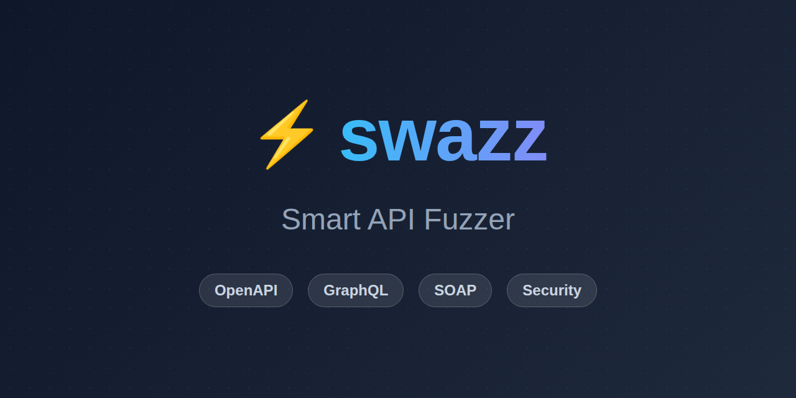

# ⚡️ swazz — Smart API Fuzzer


<p align="center">
  
</p>

[](https://github.com/SecH0us3/swazz/actions)
[](https://github.com/SecH0us3/swazz/actions)
[](https://github.com/SecH0us3/swazz/actions)
[](https://github.com/SecH0us3/swazz/actions)
[](tests/e2e)
[](https://sarifweb.azurewebsites.net/)
[](https://mariadb.com/bsl11/)
[](https://SecH0us3.github.io/swazz/)

**swazz** is a modern, smart API fuzzer designed for security researchers and developers. It parses OpenAPI (Swagger) specifications (in both JSON and YAML formats), Postman Collections, GraphQL (introspection), HAR recordings, SOAP (WSDL), gRPC services (via Protobuf `.proto` schemas or live gRPC Server Reflection), WebSocket APIs (AsyncAPI, HAR or a live `ws://` endpoint), and MCP servers to automatically identify crashes, logic flaws, and security vulnerabilities (XSS, Injection, etc.) through intelligent payload generation.

| 🌐 [**Open the dashboard**](https://swazz.secmy.app) | 📖 [**Documentation**](https://sech0us3.github.io/swazz/) | 📝 [**Blog**](https://yoursec.substack.com/t/swazz) | 🍳 [**Recipes**](https://sech0us3.github.io/swazz/recipes.html) |
| :---: | :---: | :---: | :---: |

**New here?** Pick one:
- **Browser** — sign up at [swazz.secmy.app](https://swazz.secmy.app), load a spec URL, and connect a runner from **Project Settings → Active Runners** (one `docker run` command, copied from that page). Scans run on the runner, not in your browser.
- **Terminal / CI** — download `swazz-engine-<os>-<arch>` from [Releases](https://github.com/SecH0us3/swazz/releases), rename it to `swazz-engine` and `chmod +x` it ([Download Binary](#download-binary)), run `./swazz-engine wizard`, then `./swazz-engine start --config swazz.config.json` ([Quick Start](#-quick-start)).
- **Self-host** — `git clone`, create `.env` with a `SWAZZ_RUNNER_TOKEN`, then `docker compose up --build` ([Docker & Compose](#docker--compose), [DOCKER.md](DOCKER.md), [Deployment Guide](https://sech0us3.github.io/swazz/deployment.html)).

---

## 📺 Live Demo Walkthrough

Watch **Swazz** in action as it registers a new user, loads an OpenAPI schema, fuzzes target endpoints, expands grouped findings, inspects a detailed SQL Injection error with mutation diff, and navigates project and user settings:

<p align="center">
  <video src="./docs/assets/swazz_demo.webm" width="800" controls autoplay muted loop></video>
</p>

If the player above does not load (GitHub does not always render repository-hosted video in a README), ▶️ [download or open the demo video (WebM, 7 MB)](docs/assets/swazz_demo.webm).

---

## 🧪 Test Coverage & Status

Swazz is divided into multiple packages across the stack. The coverage is continuously tracked for core components:

| Package / Module | Line Coverage / Status | Description |
| :--- | ---: | :--- |
| [**`packages/container`**](packages/container) | [](https://github.com/SecH0us3/swazz/actions) | Core Go Fuzzing Engine, Triage Workers, Classifiers |
| [**`packages/web`**](packages/web) | [](https://github.com/SecH0us3/swazz/actions) | React Frontend, Interactive Dashboard, Settings UI |
| [**`packages/edge`**](packages/edge) | [](https://github.com/SecH0us3/swazz/actions) | Cloudflare Workers API Gateway, Auth, Database Migrations |
| [**`tests/e2e`**](tests/e2e) | [](tests/e2e) | End-to-End browser test suite across 8 parallel shards |

---

## 🚀 Key Features

- **⚡️ Smart Fuzzing**: Context-aware payload generation based on parameter types and schemas, with **automatic producer→consumer DAG request chaining** (`internal/autochain`, typed state pool) and **adaptive required parameter learning** from server `400`/`422` validation feedback.
- **🛡️ 2026 Core Security Analyzers**: Specialized detection for Prototype Pollution (CWE-1321), NoSQL Injection (CWE-943), SSRF & Cloud Instance Metadata (CWE-918), JWT Alg-None / Signature Tampering (CWE-347), Mass Assignment (CWE-915), Server-Side Template Injection (`swazz/ssti-leak`, high-entropy 7–8 digit operands with hex/UUID and thousands-separator false-positive guards), BOLA / IDOR and tenant-isolation checks, rate-limit absence (`swazz/no-rate-limit`), and `multipart/form-data` / raw binary File Upload validation (`swazz/unvalidated-file-upload`, `swazz/file-parser-error`) with compile-time `//go:embed` `upload_corpus/`, `SWAZZ_UPLOAD_CORPUS_DIR` runtime override, smart endpoint type detection, second-order follow-up `GET` verification (stored SVG XSS, GIF89a polyglot/`nosniff`, PNG `tEXt` metadata strip canary, opt-in EICAR AV canary — disabled by default, enable with `--enable-eicar` or `settings.enable_eicar_probe`, triggers standard AV/EDR alerts when enabled, null-byte/RTL filenames; the follow-up is on by default and toggled with `settings.enable_upload_follow_up`), and SVG `{{OOB_URL}}` blind SSRF probing. The Request Inspector shows an **Uploaded File Probe** card and a **Second-Order Follow-Up** badge, and PoC snippets reproduce uploads as real multipart (cURL `-F`, Python `files=`, TypeScript `FormData`, Go `mime/multipart`); the toggles live in **Project Settings → Anomalies**.
- **🎮 Interactive Live Simulator**: Zero-friction attack simulation playground on the web showcase exploring BOLA, JSON SQLi, SSRF, and Mass Assignment mutation diffs.
- **🛰️ gRPC Microservice Fuzzing**: Direct fuzzing of gRPC microservices via live Server Reflection (`grpc://`, `grpcs://`) or `.proto` schema ingestion, with dynamic binary Protobuf wire serialization and specialized gRPC vulnerability analyzers.
- **🔄 Zero-Setup HAR Replay**: Import browser `.har` files directly for instant fuzzing of undocumented APIs and real-world workflows without needing an OpenAPI spec.
- **🔌 MCP Server Fuzzing**: Fuzz a target Model Context Protocol server's tools (`mcp_server` in the config, type `http`, `sse` or `stdio`); list its tools with `--mcp-list-tools` and fuzz method/tool-name dispatching with `--mcp-fuzz-methods`.
- **🔐 Auth Pipelines**: Support for complex, multi-step authentication sequences (login -> cookie collection -> fuzzing).
- **🛡️ Compliance & Taxonomy Mapping**: Automatically map all discovered vulnerabilities to both the **OWASP API Security Top 10 (2023)** and **OWASP Web Top 10 (2025)** standards, along with standard **CWE** identifiers, in reports and the Web Dashboard.
- **🎯 Precision Control**: Define custom rules to ignore specific status codes or elevate them to errors/warnings.
- **📊 Professional Reporting**: Export findings in **SARIF** (for CI/CD integration), **JSON** (full scan logs), **JUnit XML**, **Markdown**, or standalone **HTML** reports. The Web UI Findings tab also exports **Grouped Findings** as JSON or Markdown, with 1–2 representative request/response examples and redacted auth headers. In the CLI, `--json` is free; `--sarif`, `--html`, `--junit`, `--markdown` and `--waf-patch` need a license with the `report_exports` feature ([License & Pricing](#-license--pricing)).
- **🔄 Multi-Scan Comparison**: Side-by-side analysis of scan runs to compare coverage metrics, HTTP status code distributions, and findings diffs (New, Fixed, and Common vulnerabilities). **Compare Scans** requires the `cloud_history` license feature.
- **🛠 Interactive Wizard**: Fast setup with `swazz-engine wizard` — spec and base URLs, authentication, SSRF policy, fuzzing controls, wordlists and endpoint filters without manual JSON editing (`rules` for ignore/severity are still edited by hand).
- 🌐 **Web Dashboard**: Real-time Heatmap, Request Inspector, Sidebar Endpoint Tree with **Included Only** filter toggle, **Scan History** with date range and Target Base URL filtering (server-side search; **Load older matches** pages further back), and OWASP Compliance dashboard for deep-dive analysis.
- 🔔 **Real-Time Webhooks**: Deliver POST JSON payloads to external URLs on scan events and findings (see [Webhooks Guide](docs/webhooks.md)). Creating or editing webhooks requires the `scheduled_runs` license feature (commercial or trial).
- 🧩 **Browser Extension**: Chrome MV3 extension for traffic capture, one-click **Track this site**, a page crawler, HTML form / HAR import, and sync to the dashboard ([guide](https://sech0us3.github.io/swazz/browser_extension.html)).
- 🤖 **MCP Server**: Expose Swazz commands, local codebase search, and scan findings natively through Model Context Protocol.
- 🧠 **Smart Triage**: LLM-based post-scan classifier via Cloudflare AI Gateway (Gemini, OpenAI) to automatically triage noisy false positives with an AI Confidence Score.
- 🛡️ **WAF Analysis & Virtual Patch Generation**: Powered by the public [waf.secmy.app](https://waf.secmy.app) service, Swazz automatically fingerprints domain-level firewalls before scanning (`waf_check_enabled`, default true, opt-out), generates ready-to-deploy virtual patches across 9 vendor dialects (Cloudflare, AWS, GCP, Azure, ModSecurity, nginx, HAProxy, Caddy, K8s) via `--waf-patch <vendor>` (a CLI report export that requires the `report_exports` license feature), and provides an on-demand **WAF Check** tab in the web dashboard for sensitive files probing and mitigation rules. Pre-scan fingerprinting and the WAF Check tab are free and not license-gated.

---

## 📦 Installation

### Download Binary
Every push to `master` publishes a release (`rev-<commit-sha>`) on the [Releases](https://github.com/SecH0us3/swazz/releases) page with these assets: `swazz-engine-linux-amd64`, `swazz-engine-darwin-amd64`, `swazz-engine-darwin-arm64` and `swazz-engine-windows-amd64.exe` (there is no linux-arm64 build; use the [container image](#docker--compose) or [build from source](#build-from-source)). Rename the file to `swazz-engine` and make it executable:
```bash
mv swazz-engine-darwin-arm64 swazz-engine   # pick the asset for your OS/arch
chmod +x swazz-engine
./swazz-engine version
```

### Docker & Compose
We package and run the Swazz application components via Docker and Docker Compose. We publish the following container images:
- **Headless CLI Fuzzer / Scanner**: [ghcr.io/sech0us3/swazz-cli](https://github.com/SecH0us3/swazz/pkgs/container/swazz-cli)
- **Runner Agent**: [ghcr.io/sech0us3/swazz](https://github.com/SecH0us3/swazz/pkgs/container/swazz) — connects out to your edge coordinator over WebSocket and listens on no port.

For detailed instructions on running the entire Web UI, coordinator, and runner agent locally, please see the [Docker Deployment Guide](DOCKER.md).

For Kubernetes orchestration (Helm chart), please see the [Kubernetes Deployment Guide](docs/kubernetes.md).

#### Running the Headless CLI
Images are tagged `sha-<short-sha>` (for example `sha-b50b89a`), with the date and `latest` following every push to `master`; pin a `sha-` tag for anything you rely on.
```bash
docker pull ghcr.io/sech0us3/swazz-cli:sha-<short-sha>
# Run fuzzing directly (mount your config file using a volume):
docker run --rm -v $(pwd):/app ghcr.io/sech0us3/swazz-cli:sha-<short-sha> start --config /app/swazz.config.json
```

If you use this repository's Compose setup, you can launch the complete dashboard, Cloudflare coordinator, and runner agent stack. Compose refuses to start until `SWAZZ_RUNNER_TOKEN` is set, so create `.env` first:
```bash
cp .env.example .env
echo "SWAZZ_RUNNER_TOKEN=$(openssl rand -hex 32)" >> .env
docker compose up --build   # dashboard: http://localhost:3000, coordinator: http://localhost:8081
```
See [DOCKER.md](DOCKER.md) for configuration details.

#### Hosting the Dashboard Separately from the Coordinator
The dashboard's Cloudflare worker (`packages/web/worker.ts`) can serve the static UI on its own domain and proxy `/api/*` and `/health` to the edge coordinator, which avoids CORS:
1. Deploy the coordinator (`packages/edge`) as described in the [Deployment Guide](https://sech0us3.github.io/swazz/deployment.html).
2. Deploy the dashboard with `npm run deploy:web`.
3. Set the `API_URL` variable of the dashboard worker to the coordinator's URL (e.g. `https://swazz-api.yourdomain.com`).

Runner agents do not need to be reachable from the dashboard: they connect out to the coordinator over WebSocket.

### Build from Source
Requires Go 1.26.10+ (see `packages/container/go.mod`); the dashboard and edge coordinator need Node.js 22.12+ ([CONTRIBUTING.md](CONTRIBUTING.md)).
```bash
# Clone the repository
git clone https://github.com/SecH0us3/swazz.git
cd swazz

# Build the engine
cd packages/container
go build -o swazz-engine .
```

---

## 🏁 Quick Start

### 1. Interactive Setup
Run the wizard to generate your configuration file automatically. It walks you through spec URLs and the base URL, authentication (including a second BOLA identity), SSRF policy, fuzzing controls, and wordlists/endpoint filters, then saves (and optionally runs) `swazz.config.json`. Ignore/severity `rules` are not part of the wizard; add them to the file by hand (see the Configuration Example below).
```bash
./swazz-engine wizard
```

### 2. Start Fuzzing
Execute the fuzzing run using your generated config. The JSON report is free:
```bash
./swazz-engine start --config swazz.config.json --json report.json
```
SARIF, HTML, JUnit, Markdown and `--waf-patch` exports need a license key with the `report_exports` feature. Set `SWAZZ_LICENSE_KEY` (or `license_key` in the config); a 90-day trial key can be generated in **Settings → License & Subscription** on the dashboard ([License & Pricing](#-license--pricing)):
```bash
export SWAZZ_LICENSE_KEY=...   # requires report_exports
./swazz-engine start --config swazz.config.json --html report.html
```
Without that feature the paid exports are skipped and the run exits with code 1 after writing any free `--json` report.

### 3. CI/CD Integration
Fail the build if any security errors are found (exit code `2`), perfect for GitHub Actions / GitLab CI. Free, no license needed:
```bash
./swazz-engine start --config swazz.config.json --fail-on-severity error --json findings.json
```
SARIF for code-scanning upload requires the `report_exports` license feature:
```bash
export SWAZZ_LICENSE_KEY=...   # requires report_exports
./swazz-engine start --config swazz.config.json --fail-on-severity error --sarif findings.sarif
```
Without the feature, `--sarif` is not written and the run exits with code 1 (or `2` when findings meet `--fail-on-severity`, which is still evaluated); other free reports such as `--json` are still written.

### 4. Stateful API Fuzzing & Request Chaining
Swazz can extract variables from previous responses and inject them into subsequent fuzzing requests (e.g., extracting an `AUTH_TOKEN` from a `POST /login` and injecting it as a header in later requests). Add rules via the Web Dashboard, or configure them manually:
```json
{
  "settings": {
    "chaining_rules": [
      {
        "source_endpoint": "POST /api/login",
        "extract_type": "json",
        "extract_path": "data.token",
        "variable_name": "AUTH_TOKEN"
      }
    ]
  }
}
```

### 5. Fuzzing gRPC Microservices
Swazz supports native fuzzing of gRPC microservices via live Server Reflection (`grpc://` or `grpcs://`) or `.proto` files in `swagger_urls`:
```json
{
  "base_url": "grpc://localhost:50051",
  "swagger_urls": [
    "grpc://localhost:50051"
  ],
  "settings": {
    "iterations_per_profile": 10,
    "concurrency": 5,
    "profiles": ["RANDOM", "BOUNDARY", "MALICIOUS"]
  }
}
```
Run with:
```bash
./swazz-engine start --config examples/swazz.config.grpc.json --allow-private-ips --json grpc-report.json
# with a report_exports license: --html grpc-report.html
```
`--allow-private-ips` is needed only for a local target such as `localhost:50051`: private and loopback addresses are blocked by default (SSRF protection).

### 6. Fuzzing WebSocket APIs
Swazz natively supports security fuzzing of WebSocket interfaces (`ws://` and `wss://`) and event-driven architectures:
- **AsyncAPI schemas (`asyncapi.json` / `asyncapi.yaml`)**: Automatically parses channels and message schemas.
- **Recorded Traffic (`.har` files)**: Reconstructs real message envelopes captured from browser interactions.
- **Live Endpoint Synthesis (`ws://` or `wss://`)**: Generates polymorphic action/command schemas automatically.

```json
{
  "base_url": "wss://api.example.com/socket",
  "swagger_urls": [
    "wss://api.example.com/socket"
  ],
  "global_headers": {
    "Authorization": "Bearer my_jwt_token"
  },
  "settings": {
    "iterations_per_profile": 20,
    "concurrency": 5,
    "profiles": ["RANDOM", "BOUNDARY", "MALICIOUS"]
  }
}
```

### 7. Test on the Vulnerable Demo API
If you want to quickly test Swazz's capabilities, we provide built-in vulnerable APIs:
- **HTTP / REST API**: simulated as a Cloudflare Worker in `demo/`
- **gRPC Microservice API**: standalone server with Reflection in `demo/grpc/`
- **WebSocket API**: standalone server with real-time test vectors in `demo/ws/`
- **MCP servers**: a vulnerable HTTP/SSE MCP server (`node demo/mcp-sse.js`, port 8789) and a stdio one (`demo/mcp-stdio.js`)

To start the coordinator (8787), dashboard (5173), HTTP (8788), gRPC (50051) and WebSocket (50052) demo targets and a runner agent in one go, run `bash scripts/start-local-dev.sh` (stop with `bash scripts/stop-local-dev.sh`). Demo targets live on localhost, so CLI scans against them need `--allow-private-ips`.
> **⚠️ Disclaimer:** The code in the `demo/` directory is intentionally designed with vulnerabilities (SQL injection, command execution, panics) for testing Swazz. It should **NOT** be used in production or audited for security issues.

### 8. End-to-End (E2E) Browser Testing
We have a suite of Playwright E2E browser automation tests that verify integration between the frontend dashboard, the Cloudflare coordinator, the Go runner agent, and the Vulnerable Demo API.

To run Playwright tests locally:
```bash
npm install
npx playwright install chromium

# The runner script automatically builds the frontend, starts all required
# backend services (Coordinator, Demo API, Runner Agent), and executes the suite.
bash tests/e2e/run-e2e.sh

# Run a single spec instead of the whole suite (arguments go to `playwright test`):
bash tests/e2e/run-e2e.sh tests/e2e/<spec>.spec.ts
```

### 9. WAF Fingerprinting & Virtual Patch Generation
Swazz includes automated Web Application Firewall (WAF) detection powered by the public [waf.secmy.app](https://waf.secmy.app) service. Before fuzzing begins, Swazz fingerprints domain-level firewalls (Cloudflare, AWS WAF, Akamai, Imperva, etc.) and highlights detection results in the scan header badge and reports (`waf_check_enabled`, default `true`, opt-out). If confirmed exploit vectors are discovered, Swazz can synthesize ready-to-deploy mitigation rules. Fingerprinting is free; `--waf-patch` is a CLI report export and requires a license with the `report_exports` feature (`SWAZZ_LICENSE_KEY`). Without a license, copy patches from the free **WAF Check** tab in the dashboard instead.
```bash
# Run fuzzing and synthesize Cloudflare WAF mitigation rules
./swazz-engine start --config swazz.config.json --waf-patch cloudflare --waf-patch-output cf-rules.txt

# Export mitigation rules for all 9 vendor dialects (AWS, Cloudflare, GCP, Azure, ModSecurity, Nginx, HAProxy, Caddy, K8s)
# --waf-patch-output is a file path (default: waf-patch-<vendor>.txt); a matching .tf file is written alongside it when Terraform output is available
./swazz-engine start --config swazz.config.json --waf-patch all --waf-patch-output patches.txt
```
In the Web Dashboard, open the standalone **WAF Check** tab in the main results bar to run on-demand domain fingerprinting, test sensitive file protections, and copy virtual patches without running a full scan.

---

## 💻 CLI Reference

| Command | What it does |
| :--- | :--- |
| `swazz-engine start [flags]` | Run a fuzzing scan from `swazz.config.json` (local, offline mode) |
| `swazz-engine wizard` | Interactive setup that writes `swazz.config.json` |
| `swazz-engine run-agent [flags]` | Start a headless runner connected to a coordinator over WebSocket |
| `swazz-engine spider <url> [flags]` | Headless-browser crawler with CDP traffic interception |
| `swazz-engine discover [flags]` | Discover API services in a Kubernetes cluster and scan them |
| `swazz-engine generate-keys` | Generate an Ed25519 keypair for runner signing authentication |
| `swazz-engine license` | Show the active license status (reads `SWAZZ_LICENSE_KEY`) |
| `swazz-engine version` | Print the engine version (also `--version`, `-v`) |

Key `start` flags:
- **Reports**: `--json <path>` (free); `--sarif`, `--html`, `--junit`, `--markdown <path>` and `--waf-patch <vendor>` / `--waf-patch-output <path>` (need `report_exports`).
- **CI gate**: `--fail-on-severity error|warning|note|none` exits with code `2` when findings meet the threshold. `--ignore-config <path>` loads suppressions (default `swazz.ignore.json`).
- **Network policy**: `--allow-private-ips` lifts the default block on private/loopback targets; `--trusted-proxy <ip:port>` allows a local intercepting proxy from `settings.proxy_list`.
- **Fuzzing**: `--no-auto-chain` disables automatic request chaining; `--enable-eicar` turns on the EICAR upload probe; `--mcp-list-tools` / `--mcp-fuzz-methods` for MCP targets.
- **Output**: `--log-level <level>`, `--debug`, `-q` / `--quiet`, `--progress-on-change`, `--no-color`. Colors are detected automatically (on for a terminal and in GitHub Actions / GitLab CI; off with `NO_COLOR`, `TERM=dumb` or `--no-color`); `SWAZZ_LOG_FORMAT=json` switches to JSON log lines.
- **Telemetry**: the CLI sends an anonymous scan counter to `https://swazz.secmy.app/api/telemetry/scans/increment` by default. Opt out with `--disable-telemetry` or `SWAZZ_DISABLE_TELEMETRY=true`.

Exit codes: `0` success, `1` error (including a paid report export requested without a license), `2` findings at or above `--fail-on-severity`. See [Usage](https://sech0us3.github.io/swazz/usage.html) for every flag and [Environment Variables](https://sech0us3.github.io/swazz/env_variables.html) for the environment.

---

## 🔐 Authentication & Administration

### 🤖 Service Accounts & Non-Interactive Users

Administrators can directly provision new user accounts or non-interactive service accounts from the **Members & Roles** project settings tab, which requires an enterprise or trial license (`enterprise` feature).
- **Service Accounts (Non-Interactive)**: Flagged as non-interactive (API-only) to completely restrict logging in through the interactive web dashboard. Upon creation, a permanent API key starting with `swazz_live_` is generated and displayed once. These credentials can be used directly with the Swazz runner agent or automated API scripts.
- **Interactive Users**: Provisioned directly with a secure temporary password displayed once to the administrator.

---

## 🔄 CI/CD Integration

Swazz is designed to work seamlessly in continuous integration pipelines. It supports exporting fuzz results to **SARIF (Static Analysis Results Interchange Format)**, allowing you to view and manage vulnerabilities directly inside your version control platform.

*   **GitHub Actions:** Automatically runs on pull requests, reporting findings inline on the files. See the [GitHub Actions Guide](docs/ci_cd.md#github-actions--sarif-reporting).
*   **GitLab CI:** Integrates directly with GitLab's Security Dashboard (via native SARIF or converted SAST reports). See the [GitLab CI Guide](docs/ci_cd.md#gitlab-ci).

SARIF export requires a license with the `report_exports` feature (pass it as the `SWAZZ_LICENSE_KEY` secret); without one, use `--json` plus `--fail-on-severity`.

For detailed setup instructions, including advanced configuration, caching, and credential injection, check out the full [CI/CD Integration Guide](docs/ci_cd.md).

---

## ⚙️ Configuration Example

For a full set of examples (including BOLA testing, Multi-step Auth, and Petstore scans), please check out our [Cookbook & Examples Directory](examples/).

`swazz` uses a flexible JSONC configuration (JSON with comments) for fine-grained control, allowing both single-line (`//`) and multi-line (`/* */`) comments:

```json
{
  "swagger_urls": ["https://api.example.com/swagger.json"],
  "base_url": "https://api.example.com/v1",
  "wordlist_files": { // plain .txt filenames, resolved inside ./wordlists/ (relative to the working directory); paths are rejected
    "xss": "custom_xss.txt",
    "sqli": "custom_sqli.txt"
  },
  "auth_sequence": [
    {
      "type": "totp",
      "totp_secret": "JBSWY3DPEHPK3PXP", // In production, use env variables or secrets!
      "totp_variable": "totp_code"
    },
    {
      "method": "POST",
      "url": "/login",
      "body": { "user": "admin", "pass": "secret", "totp": "{{totp_code}}" }
    }
  ],
  "settings": {
    "waf_check_enabled": true, // Pre-scan WAF fingerprinting via waf.secmy.app (default true, opt-out)
    "enable_differential_analysis": true, // AST structural diffing & cross-identity BOLA chains
    "enable_security_headers_analysis": false // Set true to inspect passive HTTP headers (HSTS, CSP, XCTO)
  },
  "rules": {
    "ignore": [404],
    "severity": {
      "200": "warning",
      "403": "error"
    }
  }
}
```

---

## 🛠 Tech Stack

- **Engine**: Go (High-performance concurrency)
- **Dashboard**: React 19, Vite, Vanilla CSS
- **Input formats**: OpenAPI/Swagger 2.0 and 3.x, GraphQL (introspection), Postman Collections, HAR, SOAP (WSDL), gRPC (`.proto` / Server Reflection), WebSocket (AsyncAPI, HAR, live `ws://`), MCP servers
- **Report formats**: SARIF, JSON, JUnit XML, Markdown, HTML

## 🙈 Ignore Rules & Suppressions

To suppress false positives and filter noisy findings, Swazz supports ignore rules. You can triage findings in the Web Dashboard and download the rules config, or manually create `swazz.ignore.json` (which also supports JSONC comments) in your project root.

### Example `swazz.ignore.json`

```json
[
  {
    "rule_id": "swazz/reflected-xss",
    "endpoint": "/api/search",
    "method": "GET",
    "payload": "<script>alert(1)</script>"
  },
  {
    "endpoint": "/api/admin/*",
    "method": "DELETE"
  },
  {
    "rule_id": "swazz/status-500",
    "payload": ".*(sql|syntax|database).*"
  }
]
```

*   **`rule_id`**: Matches the Swazz vulnerability type (e.g. `swazz/sql-error-leak`, `swazz/reflected-xss`, `swazz/status-500`).
*   **`endpoint`**: Matches the request URL path. Without a wildcard the match is exact (case-insensitive). `*` matches within a single path segment (`/api/admin/*` matches `/api/admin/users` but not `/api/admin/users/42`); use `**` to cross segments (`/api/admin/**`).
*   **`method`**: Matches the HTTP request method (case-insensitive).
*   **`payload`**: Matches the request body/parameters (supports regular expressions or substring matching).
*   **`status`** (alias `status_code`): Matches the response status code — an exact code (`404`, or the number `404`) or a range (`"4xx"`, `"5xx"`).

Load a file from another location with `--ignore-config <path>`.

---

## 📚 Documentation

Comprehensive documentation, including installation guides, usage instructions, and architecture details, is available at the [Official Swazz Documentation](https://SecH0us3.github.io/swazz/).

Key pages to explore:
*   [Installation Guide](https://sech0us3.github.io/swazz/installation.html) — the three ways to run Swazz, and what a runner is
*   [Usage & Configuration](https://sech0us3.github.io/swazz/usage.html) — dashboard, CLI, `swazz.config.json` reference
*   [Recipes](https://sech0us3.github.io/swazz/recipes.html) — CI/CD, BOLA, HAR replay, gRPC, MCP, WAF patches
*   [Deployment Guidelines](https://sech0us3.github.io/swazz/deployment.html) and [Kubernetes (Helm)](https://sech0us3.github.io/swazz/kubernetes.html)
*   [CI/CD Integration Guide](https://sech0us3.github.io/swazz/ci_cd.html)
*   [Webhooks](https://sech0us3.github.io/swazz/webhooks.html) and [MCP Server](https://sech0us3.github.io/swazz/mcp.html)
*   [Architecture & Internals](https://sech0us3.github.io/swazz/architecture.html)
*   [Security Review & Threat Model](https://sech0us3.github.io/swazz/security_review.html)
*   [Environment Variables](https://sech0us3.github.io/swazz/env_variables.html), [Docker Images](https://sech0us3.github.io/swazz/docker_images.html) and [Logging](https://sech0us3.github.io/swazz/logging.html)
*   [Browser Extension](https://sech0us3.github.io/swazz/browser_extension.html), [AI Remediation](https://sech0us3.github.io/swazz/ai_remediation.html) and [DefectDojo](https://sech0us3.github.io/swazz/defectdojo.html)
*   [Sharding](https://sech0us3.github.io/swazz/sharding.html), [Queues](https://sech0us3.github.io/swazz/queues.html) and [Runner Sandboxing](https://sech0us3.github.io/swazz/runner_sandboxing_guide.html)

Release notes and deep dives are published on the [Swazz blog](https://yoursec.substack.com/t/swazz).

---

## 🧩 Adding Custom Error Detectors

New developers can easily add custom finding categories and error signature rules to the scanner. Custom detectors are defined as regex patterns in a single central registry in the backend engine:
- Edit the [custom.go](./packages/container/internal/analyzer/custom.go) file.
- Append a new `CustomRule` to the `CustomRules` slice in that file:
  ```go
  var CustomRules = []CustomRule{
      {
          RuleID:  "swazz/custom-token-leak",
          Level:   "warning", // "error", "warning", "note"
          Name:    "Custom Token Leak",
          Pattern: `(?i)custom-api-token-[a-f0-9]{32}`,
          Message: "A custom API token leak has been detected in the response body.",
      },
  }
  ```
An optional `Literals []string` field is a cheap pre-filter: case-sensitive strings of which at least one appears in every match of `Pattern`, so a response containing none of them skips the regex (leave it empty if unsure). The engine automatically runs these rules against all HTTP responses and routes findings to the dashboard and exported reports.

---

## 🤝 Contributing

Contributions are welcome! Read [CONTRIBUTING.md](CONTRIBUTING.md) for the local setup (`bash scripts/start-local-dev.sh`), tests and conventions, then open a Pull Request. Found a bug or have an idea? [Open an issue](https://github.com/SecH0us3/swazz/issues). Security issues go to [SECURITY.md](SECURITY.md), not the issue tracker.

---

## 🔒 Privacy & Data Deletion (GDPR)

Swazz supports self-service data deletion. Users can permanently and immediately delete their account, associated projects, scan histories, scan report files, and active runner connections directly from the **Danger Zone** section in the **Settings** panel. This ensures compliance with GDPR "Right to be Forgotten" policies.

---

## 📄 License & Pricing

Swazz is distributed under the **Business Source License 1.1 (BSL 1.1)**. Each version converts to the **GNU AGPL-3.0** four years after it is published (the Change Date in [LICENSE](LICENSE)).

- **Free Commercial Exemption**: Free for non-commercial use, open-source projects, and companies with under **$1,000,000 USD** in annual gross revenue.
- **90-Day Free Trial Self-Generation**: Registered users can generate a 90-day trial commercial license directly in **Settings → License & Subscription** to evaluate all enterprise capabilities (AI Remediation Pro, high concurrency, scheduled runs, report exports). A new trial key can be generated at most once every 24 hours per account.
- **Enterprise Commercial License**: Required for production commercial use by companies with annual revenue exceeding $1M USD. To request one, email license@secmy.app.
- **WAF Analysis (Free for All Users)**: Pre-scan WAF fingerprinting and the interactive Web UI **WAF Check** tab are completely free and not license-gated across all community and enterprise installations. Writing patch files from the CLI with `--waf-patch` is a report export and needs `report_exports`.
- **Feature gates**: `report_exports` (CLI `--sarif`, `--html`, `--junit`, `--markdown`, `--waf-patch`, and HTML/Markdown report downloads in Scan History; `--json` and the Findings tab's Grouped Findings export are free), `unlimited_scans` (concurrency above 5), `scheduled_runs` (scheduled scans and webhooks), `enterprise` (Members & Roles, invitations, custom roles), and `cloud_history` (Compare Scans). The CLI reads the key from `SWAZZ_LICENSE_KEY` or `license_key` in the config.
- To check the active license (Community, or your key's tier, kind, company, expiry and features), run `./swazz-engine license`; it reads `SWAZZ_LICENSE_KEY`. The full terms are in [LICENSE](LICENSE).
- For detailed pricing, feature comparisons, and licensing terms, read our [Pricing & Licensing Guide](docs/PRICING.md).
